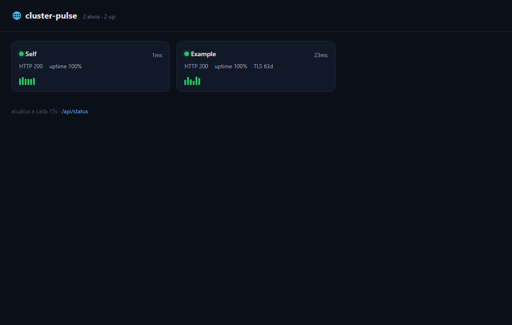

# 🌐 cluster-pulse

Self-hosted status page for a homelab. Watches a list of URLs and reports **uptime, latency and TLS-certificate expiry** on a live dashboard, and pings **Telegram** when a target flips up/down or a cert is about to expire.

Built for the exact failure mode a GitOps homelab hits: an ingress that ArgoCD reports as "Synced" but is actually returning 5xx, or a `wildcard-tls` cert quietly counting down to expiry.

## Features
- HTTP uptime + latency with a rolling uptime % and sparkline history.
- TLS leaf-cert expiry per https target (raw TLS socket, no external API).
- Telegram alert **only on state transition** (no spam) + one-shot TLS-expiry warning.
- Zero database — in-memory ring buffer, ephemeral by design. Stateless pod.
- Single dependency (`hono`); ~200 LOC.

## Screenshot


## Requisitos
- [Bun](https://bun.sh) 1.x (a imagem Docker usa `oven/bun:1`; testado com Bun 1.3).
- Opcional: Docker, para rodar a imagem.

## Instalação e uso
```bash
bun install
cp .env.example .env   # defina TARGETS
bun start              # http://localhost:3000
bun run dev            # idem, com --watch
```

Via Docker:
```bash
docker build -t cluster-pulse .
docker run --rm -p 3000:3000 --env-file .env cluster-pulse
```

## Testes, lint e build
- Testes: `bun test` (`tests/checks.test.ts`).
- Lint: o repositório não define script de lint.
- Build: não há etapa de build; o Bun executa o TypeScript direto. O artefato é a imagem do `Dockerfile`.

## Config (env)
| var | default | meaning |
|-----|---------|---------|
| `TARGETS` | `""` | `url` or `Label=url`, comma-separated |
| `CHECK_INTERVAL_MS` | `60000` | poll period |
| `CHECK_TIMEOUT_MS` | `10000` | per-request timeout |
| `TLS_WARN_DAYS` | `14` | warn when cert has ≤ N days |
| `HISTORY_LEN` | `60` | samples kept per target |
| `PORT` | `3000` | porta HTTP |
| `TELEGRAM_BOT_TOKEN` / `TELEGRAM_CHAT_ID` | — | optional alerts |

## API
- `GET /` — dashboard
- `GET /api/status` — JSON snapshot
- `GET /health` — liveness

## Gates de CI
Os três workflows em `.github/workflows` chamam workflows reutilizáveis de `juninmd/base-actions`:

| Workflow | Quando | O que checa |
|----------|--------|-------------|
| `validate.yml` | PR e push em `main` | validação padrão do base-actions (`reusable-validate`): varredura de segredos com Gitleaks, instalação de dependências, lint (não bloqueante por padrão), testes e auditoria de dependências (`high`, bloqueante) |
| `security.yml` | push em `main`, semanal (domingo 00:00 UTC), manual | scan de segurança (`reusable-security-scan`) |
| `docker.yml` | push em `main`, manual | build e push da imagem para o GHCR (`reusable-docker-build`) |

## Deploy
GitHub push → GHCR image `ghcr.io/juninmd/cluster-pulse:latest` → ArgoCD from `app-charts/cluster-pulse`. Exposed at `https://cluster-pulse.antonio-code.duckdns.org`.

MIT.
